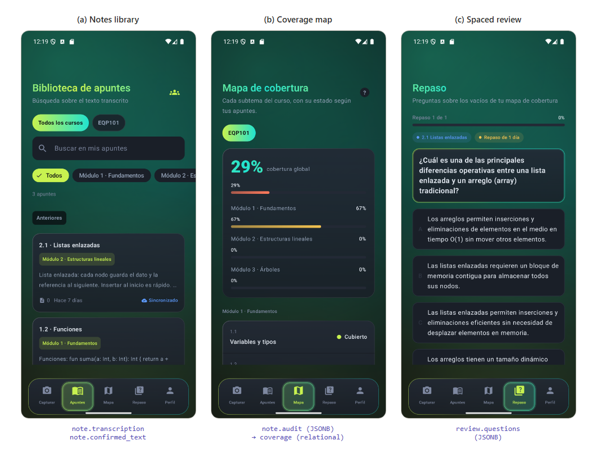

# Códice · App Android

**Códice** es un asistente de estudio con inteligencia artificial para estudiantes y profesores universitarios.
Esta es la **aplicación Android**. El servidor está en
[`codice-backend`](https://github.com/Killazz17/codice-backend).

Un estudiante fotografía sus apuntes escritos a mano; la IA los transcribe y los compara con el temario del curso para
mostrarle qué temas ya cubre y cuáles le faltan, y le arma repasos con repetición espaciada. Un profesor crea sus cursos
y grupos, publica el temario (que la IA extrae de un PDF) y ve la cobertura del grupo de forma agregada y anónima.



## Qué hace

**Estudiante**
- Registro e inicio de sesión, con bloqueo opcional por huella.
- Unirse a un curso con el código del grupo o escaneando un QR.
- Capturar un apunte con la cámara, revisar la transcripción de la IA (se marcan los bloques dudosos) y confirmarla.
- Biblioteca de apuntes con búsqueda sobre el texto transcrito.
- Mapa de cobertura del temario: qué subtemas están cubiertos, cuáles parcialmente y cuáles sin apuntes.
- Repasos con preguntas generadas por IA y repetición espaciada de 1, 3, 7, 14 y 30 días.
- Salir de un curso y cambiar la contraseña.

**Profesor**
- Crear cursos y grupos, agregar otro grupo a un curso existente y eliminar cursos sin estudiantes.
- Código de invitación y QR por grupo, con aprobación opcional de cada solicitud.
- Temario: armarlo a mano o subir un PDF y dejar que la IA lo extraiga; revisarlo y publicarlo.
- Cobertura del grupo agregada y anónima por módulo y subtema.
- Gestionar estudiantes: aprobar, rechazar o quitar.

La interfaz está en **español e inglés**.

## Cómo está hecha

Arquitectura limpia en módulos de Gradle, con la dependencia siempre hacia adentro:

```
:app                 entrada de la app y navegación
:feature:auth        inicio de sesión y registro
:feature:enrollment  cursos, grupos, invitaciones y estudiantes
:feature:notes       captura y biblioteca de apuntes
:feature:coverage    mapa de cobertura
:feature:review      repasos
:feature:syllabus    temario
:core:domain         modelos, repositorios (interfaces) y casos de uso (Kotlin puro)
:core:data           Retrofit, almacenamiento local e implementaciones de los repositorios
:core:designsystem   tema, componentes y movimiento
```

| | |
|---|---|
| **Lenguaje y UI** | Kotlin, Jetpack Compose, Material 3 |
| **Arquitectura** | MVVM + casos de uso, Hilt para inyección de dependencias |
| **Red** | Retrofit, OkHttp, kotlinx.serialization |
| **Cámara y QR** | CameraX, ML Kit y ZXing |
| **Versiones** | `minSdk` 24, `targetSdk` 37, JDK 17 |
| **Distribución** | Firebase App Distribution (ver [`docs/distribucion-firebase.md`](docs/distribucion-firebase.md)) |

## Cómo correrla

Necesitas **Android Studio** reciente y **JDK 17**.

```bash
git clone https://github.com/Killazz17/codice-android.git
cd codice-android
./gradlew :app:assembleDebug     # compila la variante debug
./gradlew test                   # corre las pruebas unitarias
```

Ábrela en Android Studio y ejecútala en un emulador o en un teléfono.

**¿Contra qué servidor se conecta?** Por defecto, tanto la variante *release* como la *debug* usan el servidor de
producción. Ese servidor de demostración puede no estar disponible. Para probar contra tu propio backend local
([`codice-backend`](https://github.com/Killazz17/codice-backend)), crea un archivo `local.properties` en la raíz con la
línea siguiente. Solo afecta a la variante debug:

```properties
# En el emulador, 10.0.2.2 es la computadora que lo ejecuta
api.baseUrl=http://10.0.2.2:8080/
```

**Firmar un release.** La llave de firma no vive en el repositorio; se lee de variables de entorno
(`CODICE_KEYSTORE`, `CODICE_KEYSTORE_PASSWORD`, `CODICE_KEY_ALIAS` y `CODICE_KEY_PASSWORD`). Sin ellas, el release
queda sin firmar. Los pasos completos están en [`docs/distribucion-firebase.md`](docs/distribucion-firebase.md).

## Más documentación

- [`docs/mockoon`](docs/mockoon): entorno de servidor simulado para desarrollar sin backend.
- [`docs/usabilidad`](docs/usabilidad): instrumento de evaluación heurística y primer informe.

## Contexto

Proyecto realizado en equipo para el curso **EIF 411, Diseño y Programación de Plataformas Móviles**, de la
Universidad Nacional de Costa Rica (2026), por Sebastián Benavides Madrigal, Mishelle Rojas Chacón y Johnny Corrales
Zamora. Es un proyecto académico: no tiene licencia de uso abierta.
